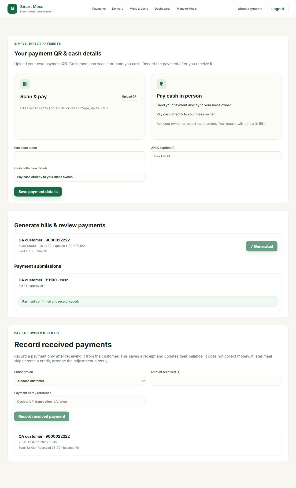

# Single-mess workflow test report

Date: 7 October 2026

## Results

33 distinct automated backend tests passed. Frontend ESLint and production build passed.
Tests used isolated in-memory databases. Browser checks used a separate SQLite database and ports 5175/8002. Existing preview customer data was not changed by test actions.

## Automated workflow coverage

| Area | Checks | Result |
| --- | --- | --- |
| Authentication | Signup/login, invalid credentials, role restrictions | Passed |
| Joining | Public mess link, selected plan, pending access restrictions, approval | Passed |
| Subscription plans | Publish/unpublish, request/approve, overlapping dates, duplicate requests, permissions | Passed |
| Public details | Saved profile, timing validation, correct public mess, saved timings preserved | Passed |
| Menu | Create/edit/delete, duplicate dates/types, nullable cutoff, learned dish choices | Passed |
| Menu photos | Upload size/type validation, owner access, save/remove, AI request format/cache/errors | Passed |
| Meal choices | Skip/undo, cutoff enforcement, duplicate guests, subscription date and role enforcement | Passed |
| Pause | Read-only preview, eligible meals, no-menu explanation, deductions only once | Passed |
| Guest pricing | Owner-only setting, 2 guests x Rs50, tampered amount ignored, price change conflict, preserved booked price | Passed |
| Preparation | Skips and multiple guests reflected in expected headcount | Passed |
| Delivery | Address/privacy, serving-end metadata, permissions, dispatched meal lock, forward-only status | Passed |
| Reviews | Past subscribed meals only, skipped meals excluded, rating/public privacy | Passed |
| Billing | Full subscription totals, guest charges, deductions, generated status, updated bills, duplicate generation | Passed |
| Payments | QR upload/replace/remove, proof authorization, submit/reject/resubmit/approve, duplicate receipts, overpayment limits, expired subscription settlement | Passed |
| Compatibility | Existing plan and guest-count schema migrations preserve records | Passed |
| Optional email | Missing SMTP configuration, mocked SMTP success/failure | Passed |

## Browser checks

Customer login; today's menu at top; two guests calculate Rs100 and bill becomes Rs3100; skip reduces bill to Rs3050; undo restores Rs3100; live-menu Back returns to customer dashboard; logout; owner login; saved public fields locked; generate bill shows Generated; create/delete disposable meal; duplicate meal error next to save controls; bill notification; auto-selected bill and prefilled payment amount; simulated cash submission; pending submission disables repeat submission; owner confirmation sets Paid Rs3100 / Due Rs0 with local success feedback.

## Fixes found during testing

1. Meal action endpoints allowed customers without a covering subscription (and owners) to change meals. Added customer-role and subscription-date checks, with regression tests.
2. The bill page unmounted its payment form during refresh, clearing its success message and resetting the method. Refresh now keeps the form mounted.
3. Added pending-payment submission state to prevent repeated clicks while waiting for owner review.
4. Live bill balances and payment receipts refresh every 15 seconds and on window focus.

## Limits

This is functional regression coverage, not a guarantee of zero bugs or a load/concurrency/security audit. API image generation was mocked in this run to avoid spending the external allowance; live Cloudflare generation succeeded earlier in this session. Actual bank/UPI transfers and real SMTP delivery were not performed. Multi-mess separation is outside the current single-mess scope. Browser file-picker actions, every mobile layout, and every validation combination were not exhaustively exercised; upload endpoints and validation were tested automatically. Delivery hiding uses configured serving end times; when a meal has no configured end time it cannot be automatically hidden by time.

## Re-run automated checks

From the repository root in PowerShell:

```powershell
$env:PYTHONPATH='backend'
backend/.runtime/Scripts/python.exe -W ignore backend/run_tests.py
```

Then run `npm run lint` and `npm run build` in `frontend`.


